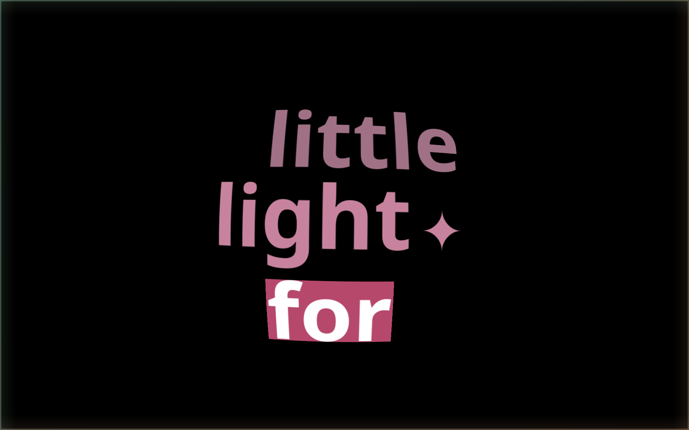
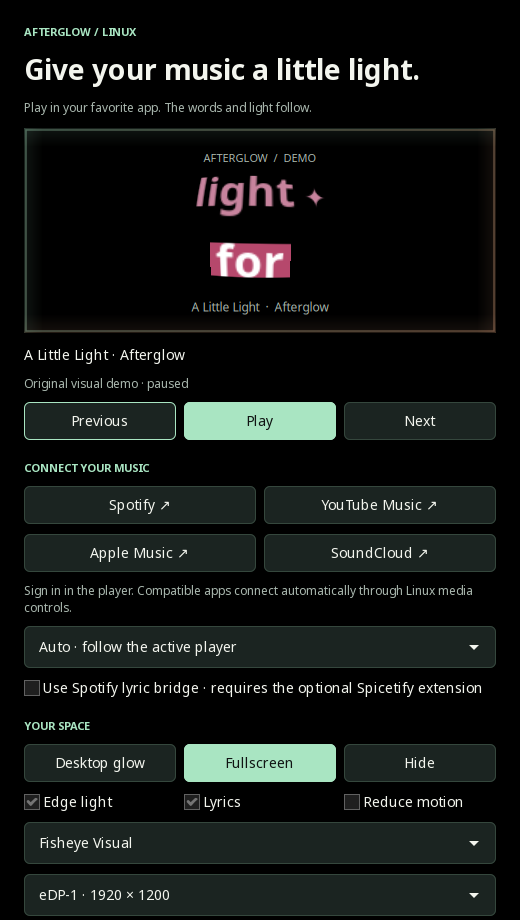

# Afterglow Linux

**Lyrics and light for the music you already play.**

A native Linux companion with audio-reactive screen-edge lighting, album-derived
colors, and an animated word-by-word lyric stack. Use it as a click-through desktop
overlay or a quiet fullscreen music view.

Inspired by the experience of [Verci](https://www.verci.xyz/) and
[Lumn](https://www.trylumn.xyz/), with an independent implementation for X11.
MIT licensed. No Afterglow account, telemetry or streaming-service API keys.



## Try it

Requires an **X11 session**, Python 3.10+, GTK3, OpenGL 3.3+ for the four lyric styles, and a PulseAudio-compatible audio
server (including PipeWire's PulseAudio support). Desktop transparency needs a
compositor, such as picom. Fullscreen can be used without desktop transparency.

On Fedora:

```bash
sudo dnf install python3-gobject python3-cairo python3-dbus gtk3 pulseaudio-utils
git clone https://github.com/UmarAlMukhtar/afterglow-linux.git
cd afterglow-linux
./afterglow-linux
```

No `pip install` or virtual environment is necessary. Use the system Python so
that its GTK bindings are available. You can also run `python3 -m afterglow` from
the checkout.

For a demo without signing into a player:

```bash
./afterglow-linux --demo
```

The demo contains original fixture lyrics and a **simulated audio envelope**. It
does not play a song or pretend to test your streaming account. Switch off its
checkbox to follow real playback.

## Connect Spotify or another provider

1. Start a song in Spotify Desktop or a compatible browser/local music player.
2. Open Afterglow. Auto follows a playing MPRIS source; use the selector if more
   than one player is active.
3. Choose **Desktop glow** or **Fullscreen**. Light and lyrics have separate switches.
4. Adjust intensity, width, lyric size and offset. A positive offset advances the
   displayed lyrics, useful when the highlight runs behind the audio.

The Spotify, YouTube Music, Apple Music and SoundCloud buttons open their official
web players. **Sign in there**, using your usual browser. Afterglow reads Linux
media controls; it never asks for your password. It does not stream songs itself,
and it cannot guarantee support for every service/browser combination. Normal
service subscriptions, account restrictions and ads still apply.

Play/pause, previous and next are available when the selected player reports that
it supports them. Escape returns from fullscreen. Space toggles playback while
the fullscreen stage has focus. **Hide** removes the desktop overlay; **Quit**
closes all visual surfaces and stops audio capture. Closing the main window quits.

## Four lyric styles

Choose **Ship**, **Fisheye**, **Fisheye Visual**, or **Visual**. All use large,
perspective word walls and a filled current-word highlight, on true black. A damped spring adds upward inertia, slow rise and independent sideways drift. The two fisheye views
use an actual GPU mesh lens; the Visual variants add matched word symbols. The
quieter line view remains available. Text is shaped with Pango for multilingual
lyrics. These are independent recreations from public visual references: proprietary
shader/code, Apple symbol assets and Verci's full private icon mapping are not copied.

## Spotify's own lyrics (optional)

The normal MPRIS connection does not expose Spotify's lyrics. An optional
[Spicetify bridge](integrations/spotify/README.md) can request them **inside Spotify**
and send only lyric data to Afterglow's authenticated loopback receiver. No Spotify
cookies or session tokens leave the Spotify client. Installing Spicetify modifies
that client and is a separate, opt-in step. The receiver is disabled by default.

Spotify's lyric endpoint is undocumented and can change or restrict access. Spotify
usually supplies line timing, so word animation can still be estimated. Imported
LRC and genuine word-timed sources retain priority. See the bridge guide for setup,
local-token handling and removal.

## Lyrics: exact when supplied, honest when estimated

Afterglow uses these sources in order:

1. An imported `.lrc` file attached to the current song.
2. A local cache.
3. [AMLL's community TTML database](https://github.com/amll-dev/amll-ttml-db), when
   the player exposes a matching Spotify track ID.
4. [LRCLIB](https://lrclib.net/) using song metadata and duration.

Enhanced LRC and TTML can carry actual word timings. Standard LRC only supplies
line starts, so Afterglow estimates the words and displays **Estimated word timing**.
Long gaps are treated conservatively; an offset can correct a constant mismatch,
but it cannot make estimated word timing exact. Plain lyrics are marked unsynced.

Word timing is not available for every song. If a lookup fails, the lighting keeps
working. Use **Retry lyrics**, or **Import LRC…** for a file you already have. Lyrics
from the wrong version/remaster may need a matching file rather than an offset.
No speech-recognition or automatic forced alignment is included.

## Privacy and local data

- Audio is read **only from the current output sink's monitor**, including a
  Bluetooth output. It is analyzed in memory and never saved or uploaded. There
  is no fallback to the microphone.
- Lyric lookups send title, artist, album and duration to LRCLIB. AMLL lookups
  contact GitHub with the Spotify track ID. Artwork is fetched from the location
  announced by the player, or read from its local file URL.
- Preferences and imported lyrics: `$XDG_CONFIG_HOME/afterglow-linux/`, defaulting
  to `~/.config/afterglow-linux/`.
- Fetched lyrics: `$XDG_CACHE_HOME/afterglow-linux/`, defaulting to
  `~/.cache/afterglow-linux/`, capped at 500 cached documents.
- No provider tokens, provider credentials, analytics, listening history, cloud account or
  automatic update executor. Pending content requests have timeouts; obsolete
  track results are ignored.
- The optional Spotify bridge has its own private local connection token and keeps received lyrics in memory.
- Corrupt preferences are preserved as `settings.json.broken` before replacement.

## Compatibility and verification

The first target is **Fedora 44, bspwm, X11, picom and PipeWire**.

| Path | Status |
|---|---|
| Native control window, demo, pause and timing offset | Checked on the target desktop |
| Desktop input region and transparency | Native X11 check; intended to pass all clicks through |
| Fullscreen and returning to controls | Checked through the GTK smoke check |
| Spotify Desktop metadata, position, artwork palette | Observed with real playback |
| Output-audio capture / nonzero reaction | Observed on the current Bluetooth sink monitor |
| MPRIS pause, track changes, disconnect/reconnect | Verified with a private D-Bus test player |
| AMLL public TTML download and parsing | Live endpoint checked |
| Spotify local lyric bridge | Lyrics received from the live Spotify session; recording availability varies |
| Four lyric styles / OpenGL lens | All four rendered and captured on AMD Radeon 780M |
| LRCLIB live lookup | Returned HTTP 502 during initial verification; retry/import remain available |
| YouTube Music / Apple Music / SoundCloud | Launch shortcuts provided; service-specific playback/login unverified |
| Bluetooth lyric alignment | Manual offset provided; perceptual alignment unverified |
| Other X11 desktops / monitor hotplug | Implemented on standard GTK/X11 interfaces; not hardware-tested |
| Wayland / secure lock screen | Outside v0.1 support |

This app uses fullscreen as a visual mode. It is **not a lock screen** and does not
replace or weaken your screen locker. A secure locker may cover its windows.
Only one selected monitor is rendered at a time. Reduce Motion is off by default; enabling it removes lyric
travel; the glow uses smoothed brightness changes rather than strobing.



## Troubleshooting

- **No player:** start playback, check its media-control integration, and select it
  explicitly. A browser may publish no artist, duration or usable timeline. A
  player without position reporting cannot produce reliable synced lyrics.
- **No light reaction:** verify the output server exposes a default sink monitor
  with `pactl list short sources`. Afterglow retries capture and follows output
  changes; it does not modify your routing.
- **No desktop transparency:** run your existing compositor or choose fullscreen.
  Afterglow does not edit compositor/window-manager settings.
- **No lyrics:** check network availability and metadata, retry, or import an LRC
  file. Community providers have gaps and can be unavailable.
- **Missing `gi`, `cairo` or `dbus`:** install the Fedora packages above and use
  `/usr/bin/python3` rather than an isolated Python environment.

## Optional launcher

No autostart or system-wide installation is performed. To add the included desktop
entry yourself, put a symlink to the checked-out executable on your user PATH and
copy the desktop file:

```bash
mkdir -p ~/.local/bin ~/.local/share/applications
ln -s "$PWD/afterglow-linux" ~/.local/bin/afterglow-linux
cp afterglow.desktop ~/.local/share/applications/
```

Keep the checkout at that path and ensure `~/.local/bin` is on your desktop PATH.
Remove those two files to remove the launcher. Your player is unaffected.

## Development

```bash
python3 -m unittest discover -s tests -v
dbus-run-session -- python3 tests/check_mpris.py
dbus-run-session -- python3 tests/check_desktop.py  # requires an X11 display
dbus-run-session -- python3 tests/check_connected.py
node tests/check_spotify_extension.cjs  # extension sandbox self-check
python3 -m compileall -q afterglow tests tools
git diff --check
```

The private-session checks do not send transport commands to your real player.
The desktop check opens and closes test windows on the current X11 display.
GTK desktop portals may emit environment warnings when the private bus exits.

`lyrics.py` owns timing/parsing; `storage.py` owns bounded retrieval/preferences;
`media.py` follows MPRIS; `audio.py` reads output PCM; `visuals.py` draws the shared
scene; `app.py` coordinates GTK, bounded content workers and controls.

## License and acknowledgments

Code and original demo fixtures: [MIT](LICENSE). Runtime/system dependencies retain
their own licenses. Lyric text and album artwork remain third-party content fetched
at runtime; they are not bundled with this repository. Respect the providers' and
rights holders' terms. This independent project is not affiliated with Spotify,
Apple, Google, SoundCloud, Verci or Lumn.

Related projects inspected before creating this combined experience:
[Lyra](https://github.com/eisewilliam/project-lyra),
[Cadence](https://github.com/MowkE/cadence),
[Vela](https://github.com/sayginsaman/Vela), and
[GLava](https://github.com/jarcode-foss/glava).
